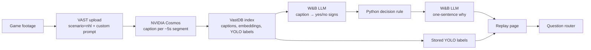

# Off-ice Flag

**Team 45 · VAST Builders Challenge: Video Agents (London, 2026)**

A replay tool for hockey trainers. Play a game, and every time players make contact a card appears saying whether the player should **Come off**, be **Watched**, or **Play on**. Each card shows the visible signs behind the call, the caption that justified it, and a one-sentence explanation. A question box answers things like *"Who should have come off?"* and jumps to the card in question.

The app never names an injury or rates how serious anything is. It only reports what is visible on screen.

> Looking for the workshop materials? The Build Day guide is now in [BUILD_DAY.md](BUILD_DAY.md). Also see [BEFORE_YOU_BUILD.md](BEFORE_YOU_BUILD.md) and [ARCHITECTURE_REFERENCE.md](ARCHITECTURE_REFERENCE.md).

## How it works



1. **Upload.** One file holds the whole game. It goes to VAST with our ingest prompt ([contracts/ingest_prompt.txt](contracts/ingest_prompt.txt)), which asks Cosmos to describe contact, the head or neck, slow-to-rise, leaving the ice, and favouring a limb.
2. **Index.** The VAST DataEngine pipeline cuts the file into segments of about 5 seconds. Cosmos writes a caption for each one, and the pipeline stores embeddings and YOLO detections next to it.
3. **Extract signs.** While indexing runs, a background builder polls VAST every 15 seconds. For each new caption, Weights & Biases inference (Llama 3.3 70B, temperature 0) returns `contact`, four yes/no signs, and an `evidence_quote` copied word for word from the caption. A segment with no contact never becomes a card.
4. **Decide.** Python applies the rule below. The model never picks the decision word.
5. **Explain.** Weights & Biases turns each card's trace into a single *why* sentence. Python rejects any sentence that is missing the quote or the decision words, or that uses medical wording.
6. **Replay.** The page plays the cards in order. Play on and Watch keep playing, and Come off pauses the video. Cards appear as they are indexed, so you don't have to wait for the whole game.

### Signs and decision rule

| Sign | True when the caption says |
|---|---|
| `head_neck` | The head or neck is involved in the contact |
| `slow_to_rise` | A player is slow to get up or stays down |
| `left_ice` | A player skates to the bench or leaves the ice |
| `favoring_limb` | A player favours an arm or leg afterwards |

| Decision | When |
|---|---|
| **Come off** | `left_ice` or `slow_to_rise`, or two or more signs |
| **Watch** | Contact with exactly one other sign |
| **Play on** | Contact, no signs |
| *(no card)* | No contact |

Each card shows **Visible signs n of 4**. This is a count of how many signs the caption states, not a severity score.

### Questions

| Question type | Answered from |
|---|---|
| Decisions: *"Who should have come off?"*, *"Was the head involved?"* | The cached why sentences for the matching cards. No new model call, so the answer always agrees with the card. |
| Objects in frame: *"What's in the frame?"* | Stored YOLO label counts |
| Recap: *"What happens in this clip?"* | A VAST `synthesize` summary over the captions |
| Anything else | VAST `agent/ask`, limited to this clip |

Six saved questions are worked out ahead of time, so the demo never has to wait on a model.

## Where each sponsor fits

- **VAST:** stores and streams the clip, runs the segment → caption → embed → detect pipeline, hybrid footage search, agent ask, and the clip recap.
- **NVIDIA Cosmos:** writes every segment caption, steered by our ingest prompt. The stored **YOLO11** labels supply the "In frame: person 2" line on each card.
- **Weights & Biases (by CoreWeave):** serverless inference turns captions into signs and phrases the why sentences.
- **CoreWeave:** GPUs under the models. The app never calls the GPU hosts directly.

## Repo layout

```text
tools/off-ice-flag/        the app
  main.py                  FastAPI wiring and routes (Lane D)
  vss_client.py            every VAST HTTP call, plus a CLI (Lane A)
  decision.py              W&B calls, sign extraction, decision rule, why sentence (Lane B)
  questions.py             tape builder, saved questions, live question router (Lane D)
  eval.py                  scores the eight hand labels (Lane D)
  static/                  replay page: HTML, CSS, vanilla JS (Lane C)
  deploy/off-ice-flag.yaml Kubernetes manifest (no Docker build)
  test_offline.py          offline tests with VAST and W&B faked
contracts/                 JSON schemas (contract v2), ingest prompt, fixtures
docs/OFF_ICE_FLAG_SPEC.md  full product spec, the source of truth
docs/AGENT_CONTRACTS.md    who owns which files, plus a starter prompt per lane
docs/EVAL.md               evaluation procedure
.cursor/                   workshop skills and Cursor rules
```

## Running it

### Locally, against fixtures

If nothing is loaded in either tab (`OFF_ICE_CHUNKS` and `OFF_ICE_ORIGINAL_VIDEO` unset), the app serves the four sample cards in [contracts/fixtures/](contracts/fixtures/) and calls neither VAST nor W&B. Every API response then carries the `X-Off-Ice-Fixture: 1` header.

```bash
cd tools/off-ice-flag
pip install -r requirements.txt
python main.py                # http://localhost:8080
```

Offline tests:

```bash
pip install jsonschema httpx -r requirements.txt
python test_offline.py
```

### On the workshop VM, with the real clip

```bash
cd tools/off-ice-flag
python vss_client.py login
python vss_client.py split game.mp4              # lossless parts under the 100 MB upload cap (stream copy)
python vss_client.py upload game_part_*.mp4      # one confirmation, then uploads every part
python vss_client.py find game_part              # original_video URIs once indexed
python vss_client.py segments <original_video>   # check captions and segment counts
```

Then open the app's **Split game** tab, click **Load videos**, and tick the parts. They play in file-name order on one game clock. The **Whole video** tab takes a single upload under the cap. To make a load survive pod restarts, set `OFF_ICE_CHUNKS` (comma-separated part URIs, in order) or `OFF_ICE_ORIGINAL_VIDEO` in the Secret. The app also reads `VSS_URL`, `VSS_USERNAME`, `VSS_PASSWORD`, `WANDB_API_KEY`, optional `WANDB_INFERENCE_BASE`, and `PORT`.

### Deploy

Deploy to the `team-45` namespace with the `deploy-app-no-registry` skill. It uses a public `python:3.12-slim` image, mounts the code as ConfigMaps, and serves at Ingress path `/app`. The full command sequence is at the top of [tools/off-ice-flag/deploy/off-ice-flag.yaml](tools/off-ice-flag/deploy/off-ice-flag.yaml). To open the app, go to [workshop.thecosmoslabs.com](https://workshop.thecosmoslabs.com) and click **App**.

## HTTP API

| Method | Path | Returns |
|---|---|---|
| GET | `/health` | `{ "ok": true }` |
| GET | `/` | Replay page |
| GET | `/api/tape` | Cards sorted by `start_sec`, with `status`: `ready`, `indexing`, or `missing_clip` |
| GET | `/api/segments/{id}/stream` | Proxied video for a card (the VAST JWT never reaches the browser) |
| GET | `/api/segments/{id}/detections` | Stored YOLO label counts, or `available: false` |
| GET | `/api/cards/{id}/why` | Cached why sentence |
| GET | `/api/questions` | The six saved questions and their answers |
| POST | `/api/ask` | `{ "question": "..." }` → one live answer |
| GET | `/api/search?q=` | VAST hybrid search over this game, mapped to cards |
| GET | `/api/sources` | What the Split game and Whole video tabs have loaded |
| POST | `/api/sources/{chunks\|whole}` | `{ "videos": [...] }` → load a tab |
| GET | `/api/library` | Indexed uploads in VAST, for the loader |
| GET | `/api/eval` | Match score against the eight hand labels |

Schemas for every response are in [contracts/](contracts/).

## Evaluation

We labelled eight moments by hand while watching the real clip. A label matches when a card starts within 5 seconds of it and has the same decision. If the decision matches but the signs differ, it still counts as a miss. See [docs/EVAL.md](docs/EVAL.md). The fixture score in `contracts/fixtures/eval.json` is a placeholder, not our result.

## Two-minute demo

1. Press play. The first bump is marked **Play on**, with its why sentence and in-frame line, and the tape keeps going.
2. The big hit pauses on **Come off**. Read the signs (slow to rise, leaves the ice), the why sentence, and the caption.
3. Ask *"Who should have come off?"*. The saved answer jumps back to that same card.

## Working on this repo

- Read [docs/OFF_ICE_FLAG_SPEC.md](docs/OFF_ICE_FLAG_SPEC.md) and [docs/AGENT_CONTRACTS.md](docs/AGENT_CONTRACTS.md) first.
- Each lane edits only its own files. A schema change means a `contract_version` bump, with the schemas, fixtures and both docs updated in one commit whose message starts with `contract:`.
- Never commit secrets, JWTs, `WANDB_API_KEY`, or `/config/team-45.config`.
- Footage must be ours or properly licensed. No YouTube or other internet video.

**Out of scope:** live camera, severity scores, injury names, jersey tracking, speech-to-text, and drawing detection boxes on the video.
