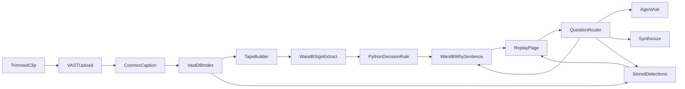

# Off-ice Flag

Contract version **2**. Team 45. One product, one page, one clip.

A trainer plays a trimmed hockey period. When players make contact, a card appears. The card shows four visible signs, a decision, the caption that justified it, a one-sentence why, and the object labels stored for that segment. **Come off** pauses the playback. **Watch** and **play on** let it continue. A question box on the same clip answers either from those decisions or from the clip.

The decision is only `come_off`, `watch`, or `play_on`. The product does not name an injury or say how serious one is.

Version 2 adds the why sentence, stored detector labels, and a question router. The decision rule is the same rule as version 1.

Long-clip update (same schemas, still version 2): one upload holds a whole game, VAST segments it, and the tape fills in while it indexes. See [Pipeline](#pipeline) and [Replay](#replay).

## Judging

Source: [JUDGING.md](../JUDGING.md) on the VM (root markdown is gitignored; the criteria are repeated here).

Submit by 4:30 PM at https://tokensand.com/vastlondon/submit. First round is a 2 minute live demo. Top 5 present for 3 minutes at 6pm. Demos, not slides.

| Criterion | What this product shows |
|---|---|
| Idea | A trainer sees who should leave the ice, why that decision fired, and can ask about that moment. |
| Design | One page. Play, pause on come off, card with the why sentence and the in-frame line, then a question that opens the same card. |
| Technical implementation | The prompt, the schemas, the Python rule, the question router, and [EVAL.md](EVAL.md) are the inputs, outputs, and check. |
| Impact | VAST stores and plays the clip, answers a clip question, and writes the recap. NVIDIA Cosmos writes the caption because of the upload prompt. Stored YOLO labels are read back onto the card. Weights & Biases turns that caption into yes/no signs and phrases the why sentence. |
| Presentation | Play a bump, pause on the stay-down, read the why sentence, ask who should have come off. About two minutes. |

Sponsors named on the room banner: tokens&, VAST, CoreWeave, SpaceX, NVIDIA, Weights & Biases by CoreWeave. The three the demo must show doing work are VAST, NVIDIA Cosmos, and Weights & Biases. CoreWeave is the hardware under those models. The in-frame line is the stored YOLO pass from that same pipeline. The app does not call the GPU hosts.

## Clip

The lab archive has no hockey. The demo needs one file the team can use.

- One file for the whole game or period. VAST's segmenter cuts it into segments of about five seconds itself; the app does not split video.
- `.mp4` or `.mov`, under the backend upload cap (`max_upload_size_mb` from `GET /api/v1/config`, about 100 MB). Other allowed extensions are `.webm`, `.avi`, `.mkv`. A long game is re-encoded to fit: `python tools/off-ice-flag/vss_client.py upload <file>` prints the ffmpeg command and bitrate when the file is over the cap.
- One angle. Play in order.
- Visible on screen without narration: one hit where a player stays down or leaves the ice, and one bump where both players get straight up.
- Footage the team filmed or has rights to. Do not download YouTube or other internet video.

Until that file is on the VM, every lane builds against the fixtures in [contracts/fixtures/](../contracts/fixtures/). `tape.json` is the clip. `why.json`, `detections.json`, and `questions.json` match those four cards.

## Pipeline



1. Upload the file with `scenario=nhl` and the custom prompt in [contracts/ingest_prompt.txt](../contracts/ingest_prompt.txt) (412 characters; the API cap is 800). The custom prompt overrides the preset text. `nhl` is only the scenario label.
2. The running pipeline cuts the file into segments of about five seconds. Cosmos writes a caption per segment. Embeddings and YOLO detections are stored with it. The app does not call the GPU hosts.
3. A background builder polls VAST every 15 seconds and takes the segments that are searchable so far, in batches of 32. It does not wait for the whole game.
4. For each caption, Weights & Biases returns contact, the four signs, and a short quote copied from the caption. Temperature is 0. The reply is JSON only. A segment whose caption does not describe body contact is not a card.
5. Python applies the rule below and emits a card.
6. Weights & Biases phrases the why sentences for that batch's cards, 20 cards per call. Python checks the sentences. A sentence that fails the check is dropped. The card stays.
7. The app reads each new card's stored YOLO sidecar and keeps label counts. A missing sidecar stores `available: false`. It does not invent a label.
8. After each batch the tape is republished, sorted by `start_sec`, with status `indexing`. When VAST reports every segment indexed and every segment is processed, the clip recap runs once and the status becomes `ready`.
9. The page plays the cards in order. The why sentence and the in-frame line are already cached. The pause does not wait on a model.

Indexing a full game takes a while on the shared GPUs. Cards show up while it runs. Playback is the real-time behavior: the action fires when that segment comes up. There is no live camera.

A sign extraction that fails is retried on the next poll, up to three times. After that the segment is left out and logged. It is never guessed.

All VAST HTTP lives in `tools/off-ice-flag/vss_client.py`. All Weights & Biases HTTP lives in `tools/off-ice-flag/decision.py`. Those two modules do not import each other.

## Signs

A sign is true only when the caption states it.

| Field | True when the caption says |
|---|---|
| `head_neck` | The head or neck is involved in the contact. |
| `slow_to_rise` | A player is slow to get up or stays down. |
| `left_ice` | A player skates to the bench or leaves the ice. |
| `favoring_limb` | A player favors an arm or a leg after the contact. |

Plain words for a true sign, used in the why sentence: head, slow to rise, leaves the ice, favors a limb.

## Decision rule

Implemented in `tools/off-ice-flag/decision.py`. The model does not choose the word.

- `come_off` if `left_ice` or `slow_to_rise` is true, or if two or more signs are true.
- `watch` if `contact` is true and exactly one sign is true, and that sign is not `left_ice` or `slow_to_rise`.
- `play_on` if `contact` is true and every sign is false.
- No contact: the segment is omitted. It is not a card.

`evidence_quote` must be a phrase that appears in `caption`.

### Clause

The clause names which bullet fired. It does not change the decision. First match wins:

| Order | Clause | When |
|---|---|---|
| 1 | `left_ice` | `left_ice` is true. Decision is `come_off`. |
| 2 | `slow_to_rise` | `slow_to_rise` is true. Decision is `come_off`. |
| 3 | `two_or_more` | Two or more signs are true. Decision is `come_off`. |
| 4 | `one_sign` | Exactly one sign is true. Decision is `watch`. |
| 5 | `no_signs` | Every sign is false. Decision is `play_on`. |

`signs_true` lists the true sign fields in this order: `head_neck`, `slow_to_rise`, `left_ice`, `favoring_limb`.

## Card

The only UI for a hit. Fields are [contracts/card.schema.json](../contracts/card.schema.json).

- The clip, from `GET /api/segments/{id}/stream`.
- The four signs as yes or no.
- The decision: Come off, Watch, or Play on.
- The caption underneath.
- The why sentence, from `GET /api/cards/{id}/why`. Shape: [contracts/why.schema.json](../contracts/why.schema.json).
- One in-frame line, from `GET /api/segments/{id}/detections`. Shape: [contracts/detections.schema.json](../contracts/detections.schema.json). Example: `In frame: person 2`. Omit the line when `available` is false.

No coach note, no scout note, no severity word, no injury name. No boxes drawn on the video.

A why response that is not 200 leaves the sentence off. A detections response that is not 200 leaves the in-frame line off. The card from the tape still shows.

## Replay

`GET /api/tape` returns cards sorted by `start_sec`. The page plays them in that order through the stream proxy.

While `status` is `indexing`, the tape holds the cards built so far. The page shows the status, plays what is there, and polls `GET /api/tape` about every 15 seconds to pick up new cards. `missing_clip` means VAST has nothing for this video yet: show the status and no cards.

- Play on: show the card briefly and continue.
- Watch: show the card and continue.
- Come off: pause on that clip with the decision on screen. Resume continues down the tape.

The browser never receives the VAST JWT. The app proxies the stream.

## Why sentence

Computed when each batch of cards is built, then cached. `GET /api/cards/{id}/why` reads the cache.

Weights & Biases receives the traces only: card id, decision, clause, signs, and `evidence_quote`. Temperature is 0. The reply is one JSON object:

```json
{ "sentences": [ { "id": "seg-down", "sentence": "Come off. ..." } ] }
```

Python accepts a sentence only when all of these hold:

- It contains that card's `evidence_quote` as a substring.
- It contains the decision words for that card: `Come off`, `Watch`, or `Play on`.
- It is at most 800 characters.
- It does not contain, in any case: injury, injured, concussion, fracture, fractured, sprain, tear, torn, severe, severity, diagnosis, medical.

A rejected sentence or a failed call does not invent a why. That card's why is absent. The other cards keep theirs. The tape of cards still returns.

The fixture sentences are [contracts/fixtures/why.json](../contracts/fixtures/why.json). They already pass these checks. While `X-Off-Ice-Fixture` is `1`, the why route returns those sentences and does not call Weights & Biases.

## Detections

`GET /api/segments/{id}/detections` returns label counts for that card's segment. Lane A reads `GET /api/v1/videos/detections?source=` (the videos skill). The JWT stays on the server.

Count string values found on each detection object under `label` or `class_name`. Ignore box coordinates. If that walk finds no label, `available` is false and `objects` is empty. A 404 from VAST is the same outcome. Do not guess a class name.

The fixture counts are [contracts/fixtures/detections.json](../contracts/fixtures/detections.json). They are stand-in labels for the four fixture cards, not a claim about a real sidecar.

Cached at tape build, same as the why sentence. The pause reads the cache.

## Question base

Saved questions are answered when the tape is built, so the stage does not wait. Shape: [contracts/question.schema.json](../contracts/question.schema.json). The list is `GET /api/questions`.

| id | Question | Grounding | Tools |
|---|---|---|---|
| `who-comes-off` | Who should have come off? | decision | rule, wandb |
| `why-come-off` | Why is that a come off? | decision | rule, wandb |
| `head-involved` | Was the head involved in any contact? | decision | rule, wandb |
| `played-through` | Which hits did they play through? | decision | rule, wandb |
| `before-come-off` | What happened just before the come-off? | decision | rule, wandb |
| `clip-recap` | What happens in this clip? | clip | synthesize |

`grounding` is `decision` or `clip`. `tools` names the path. Decision answers use `rule` then `wandb`. The UI prints those two words under the answer in one line.

Clicking an answer seeks to the first `card_ids` entry. An empty `card_ids` leaves the playhead where it is.

A saved decision answer is the cached why sentences for the cards that question selects, joined in `start_sec` order with a space. Building the list does not call Weights & Biases again, so the question and the card cannot disagree. Each of those sentences already contains the `evidence_quote` and the decision words. The fixture file is that join for the four fixture cards.

`clip-recap` is the precomputed `POST /api/v1/videos/synthesize` for this `original_video`. The system prompt is: "Summarize only what the segment captions show, in order. Do not say come off, watch, or play on. Do not name an injury or its severity. Do not add people or actions that are not in the captions." Reject a recap that contains a banned word or the decision words `come off`, `watch`, or `play on`. Map caption times to `card_ids` by overlap, in `start_sec` order. The fixture recap is the stand-in until that call has run.

### Live ask

`POST /api/ask` with `{ "question": "..." }` returns one question object, `source: "live"`. The router is keyword matching, in this order. First match wins. Matching is case insensitive.

1. **Detections** if the text contains any of: `in frame`, `in the frame`, `detected`, `detection`, `bounding`, `what objects`, `what's in`, `what is in`. Answer from cached label counts. `grounding` is `clip`. `tools` is `["detections"]`. Python writes the sentence (`In frame: person 2`). No model call. If every selected card has `available: false`, the answer is `No stored detections for that moment.`
2. **Decision** if the text contains a phrase or a whole word from the decision list below. Join the cached why sentences for the selected cards, in `start_sec` order, with a space. Do not call Weights & Biases again. `grounding` is `decision`. `tools` is `["rule", "wandb"]`. If no card matches, the answer is `No card on this clip matches that.` and `tools` is `["rule"]`. If cards match and every one of them has no cached sentence, respond 502 and do not write a substitute.
3. **Synthesize** if the text contains `summar`, `recap`, `what happens in this clip`, `what happens in the clip`, `what happened in this clip`, or `what happened in the clip`. Call synthesize as for `clip-recap`. `grounding` is `clip`. `tools` is `["synthesize"]`.
4. **Agent ask** otherwise. `POST /api/v1/agent/ask` with `original_video` set to this clip only (the agent-qa skill). Map `evidence` segments to `card_ids` by time overlap. `grounding` is `clip`. `tools` is `["agent_ask"]`. Reject an answer that contains a banned word. Do not show the rejected text.

Decision phrases: `come off`, `come-off`, `come_off`, `play on`, `play-on`, `play_on`, `play through`, `played through`, `leaves the ice`, `left the ice`, `skates to the bench`, `slow to`.

Decision whole words: `why`, `watch`, `bench`, `head`, `neck`, `sign`, `signs`, `favor`, `favour`, `favoring`, `favouring`. A whole word starts and ends at a letter boundary.

Saved decision questions use this same card filter. So do live steps 1 and 2, after the route is chosen:

- `come off` in any spelling selects `come_off` cards.
- Otherwise `play on`, `play through`, or `played through` selects `play_on` cards.
- Otherwise the whole word `watch` selects `watch` cards.
- Otherwise a sign word selects cards where that sign is true. `head` and `neck` map to `head_neck`. `slow`, `stays down`, and `stay down` map to `slow_to_rise`. `bench`, `leaves the ice`, and `left the ice` map to `left_ice`. `favor` and `favour` map to `favoring_limb`. More than one sign word takes the union.
- Otherwise a bare `why` selects the `come_off` cards when any exist, and all cards when none exist.
- Otherwise all cards.
- `before` also includes the contact card immediately before each selected card. `after` includes the next one. Keep `start_sec` order.

This product does not call `POST /api/v1/agent/search-and-answer`. That route is for filtered search across the archive. This clip is already known, so clip questions use agent ask with `original_video`.

While the fixture header is set, live ask uses the fixture tape, why sentences, detections, and clip recap. It does not call VAST or Weights & Biases. `tools` still names the production path. The header is what marks the body as a fixture.

## Evaluation

Eight moments, labeled by hand while watching the real clip. Procedure and match rule: [EVAL.md](EVAL.md). Schema: [contracts/eval.schema.json](../contracts/eval.schema.json). Misses stay in the note. The fixture file is not the demo score.

The eight moments score the decision on the card. They do not score why sentences, detector labels, or question answers.

## Stack

One app. The deploy path is [.cursor/skills/deployment/deploy-app-no-registry/SKILL.md](../.cursor/skills/deployment/deploy-app-no-registry/SKILL.md): `python:3.12-slim`, code in a ConfigMap under about 1 MiB, container routes at `/`, Ingress path `/app`. No Docker build, no Node, no `node_modules`.

| Piece | Choice |
|---|---|
| Language | Python 3.12 |
| Server | FastAPI and uvicorn, pinned in `tools/off-ice-flag/requirements.txt` when implementation starts |
| UI | One HTML page, CSS, and vanilla JS. No build step. |
| VAST | Login, upload, list segments, agent ask, synthesize, stored detections, stream proxy. Skills in `.cursor/skills/retrieval/` and `.cursor/skills/ingest/upload-video/`. |
| NVIDIA | Cosmos captions via the ingest prompt. YOLO labels read from the stored sidecar. The app does not call `COSMOS3_REASON_URL` or the detector host. |
| Weights & Biases | `POST {base}/chat/completions` with `WANDB_API_KEY`. Default base `https://api.inference.wandb.ai/v1`. Lane B confirms the model id from `GET /v1/models` and pins it in `decision.py`. One model id for signs and for the why sentence. |
| Deploy | Team namespace, Ingress host from the team config, path `/app`. People open https://workshop.thecosmoslabs.com and click **App**. |

Environment the app may read: `VSS_URL`, `VSS_USERNAME`, `VSS_PASSWORD`, `WANDB_API_KEY`, optional `WANDB_INFERENCE_BASE`, `OFF_ICE_ORIGINAL_VIDEO`, `PORT`. Credentials stay in the environment or the Kubernetes Secret. Do not commit `/config/team-45.config` or any token.

## HTTP

Ingress `/app` is stripped. The process serves `/`.

| Method | Path | Body | Result |
|---|---|---|---|
| GET | `/health` | | `{ "ok": true }` |
| GET | `/` | | The replay page |
| GET | `/api/tape` | | Tape schema. `status` is `ready`, `indexing`, or `missing_clip`. |
| GET | `/api/segments/{id}/stream` | | Proxied video bytes for that card |
| GET | `/api/segments/{id}/detections` | | Detections schema. `available: false` when the sidecar has no labels |
| GET | `/api/cards/{id}/why` | | Why schema |
| GET | `/api/questions` | | `{ "contract_version": 2, "questions": [ ... ] }` |
| POST | `/api/ask` | `{ "question": "..." }` | One question object, `source: "live"` |
| GET | `/api/eval` | | Eval schema |

Errors: unknown card id is 404. Ask with an empty question is 400. Tape status `missing_clip` on ask, why, detections, or stream is 409 with `{ "error": "not_ready", "status": "missing_clip" }`. While `indexing`, those routes answer from the cards built so far. `GET /api/eval` is 409 until the tape is `ready`. Upstream failure, or a model reply that fails the checks above, is 502 with `{ "error": "upstream" }` and no invented sentence or card.

Until `OFF_ICE_ORIGINAL_VIDEO` is set, tape, why, detections, and questions may return the fixtures, with `video_id` `fixture-period` on the tape. Set `X-Off-Ice-Fixture: 1` on those responses. Do not present fixture cards as the judged clip.

## Two-minute demo

1. Press play. The bump is marked play on. The card shows the why sentence and the in-frame line. The tape continues.
2. The come-off hit pauses. Read the signs, the why sentence (slow to rise and leaves the ice), then the caption line. The in-frame line is already there.
3. Ask "Who should have come off?" The saved answer opens that same card.

If the live ask is slow, use the saved question. Do not wait on a fresh model call on stage. "Why is that a come off?" and "What happens in this clip?" are on the same list when there is time.

## Out of scope

A live camera. A severity score. Injury names. A scout report. A second game. Jersey tracking across the clip. Canary speech-to-text. Calling the GPU endpoints from the app. Re-ingesting the whole lab archive. Filtered archive search (`POST /api/v1/agent/search-and-answer`). Drawing detection boxes on the video.

## Repo map

Implementation files are created by the lanes in [AGENT_CONTRACTS.md](AGENT_CONTRACTS.md). They are not in the repo until that lane lands them.

```text
docs/OFF_ICE_FLAG_SPEC.md
docs/AGENT_CONTRACTS.md
docs/EVAL.md
contracts/ingest_prompt.txt
contracts/card.schema.json
contracts/tape.schema.json
contracts/why.schema.json
contracts/detections.schema.json
contracts/question.schema.json
contracts/eval.schema.json
contracts/fixtures/tape.json
contracts/fixtures/why.json
contracts/fixtures/detections.json
contracts/fixtures/questions.json
contracts/fixtures/eval.json
.cursor/rules/off-ice-flag.mdc
tools/off-ice-flag/   # created during implementation
```
