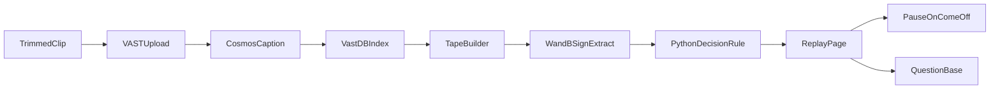

# Off-ice Flag

Contract version **1**. Team 45. One product, one page, one clip.

A trainer plays a trimmed hockey period. When players make contact, a card appears. The card shows four visible signs, a decision, and the caption that justified it. **Come off** pauses the playback. **Watch** and **play on** let it continue. A question box on the same clip answers from those cards.

The decision is only `come_off`, `watch`, or `play_on`. The product does not name an injury or say how serious one is.

## Judging

Source: [JUDGING.md](../JUDGING.md) on the VM (root markdown is gitignored; the criteria are repeated here).

Submit by 4:30 PM at https://tokensand.com/vastlondon/submit. First round is a 2 minute live demo. Top 5 present for 3 minutes at 6pm. Demos, not slides.

| Criterion | What this product shows |
|---|---|
| Idea | A trainer sees who should leave the ice, and can play that moment. |
| Design | One page. Play, pause on come off, card, then a question that opens the same card. |
| Technical implementation | The prompt, the schemas, the Python rule, and [EVAL.md](EVAL.md) are the inputs, outputs, and check. |
| Impact | VAST stores and plays the clip. NVIDIA Cosmos writes the caption because of the upload prompt. Weights & Biases turns that caption into yes/no signs. |
| Presentation | Play a bump, pause on the stay-down, ask who should have come off. About two minutes. |

Sponsors named on the room banner: tokens&, VAST, CoreWeave, SpaceX, NVIDIA, Weights & Biases by CoreWeave. The three the demo must show doing work are VAST, NVIDIA Cosmos, and Weights & Biases. CoreWeave is the hardware under those models.

## Clip

The lab archive has no hockey. The demo needs one file the team can use.

- `.mp4` or `.mov`, **100 MB or under**. Other allowed extensions are `.webm`, `.avi`, `.mkv`.
- Two to four minutes. One angle. One stretch of play, in order.
- Visible on screen without narration: one hit where a player stays down or leaves the ice, and one bump where both players get straight up.
- Footage the team filmed or has rights to. Do not download YouTube or other internet video.

Until that file is on the VM, every lane builds against [contracts/fixtures/tape.json](../contracts/fixtures/tape.json).

## Pipeline



1. Upload the file with `scenario=nhl` and the custom prompt in [contracts/ingest_prompt.txt](../contracts/ingest_prompt.txt) (412 characters; the API cap is 800). The custom prompt overrides the preset text. `nhl` is only the scenario label.
2. The running pipeline cuts the file into segments of about five seconds. Cosmos writes a caption per segment. Embeddings and YOLO detections are stored with it. The app does not call the GPU hosts.
3. When the segments are searchable, the app drops any segment whose caption does not describe body contact, and sorts the rest by `start_sec`.
4. For each remaining caption, Weights & Biases returns the four signs and a short quote copied from the caption. Temperature is 0. The reply is JSON only.
5. Python applies the rule below and emits a card.
6. The page plays those cards in order.

Indexing a new file takes minutes. Playback after that is the real-time behavior: the action fires when that segment comes up. There is no live camera.

## Signs

A sign is true only when the caption states it.

| Field | True when the caption says |
|---|---|
| `head_neck` | The head or neck is involved in the contact. |
| `slow_to_rise` | A player is slow to get up or stays down. |
| `left_ice` | A player skates to the bench or leaves the ice. |
| `favoring_limb` | A player favors an arm or a leg after the contact. |

## Decision rule

Implemented in `tools/off-ice-flag/decision.py`. The model does not choose the word.

- `come_off` if `left_ice` or `slow_to_rise` is true, or if two or more signs are true.
- `watch` if `contact` is true and exactly one sign is true, and that sign is not `left_ice` or `slow_to_rise`.
- `play_on` if `contact` is true and every sign is false.
- No contact: the segment is omitted. It is not a card.

`evidence_quote` must be a phrase that appears in `caption`.

## Card

The only UI for a hit. Fields are [contracts/card.schema.json](../contracts/card.schema.json).

- The clip, from `GET /api/segments/{id}/stream`.
- The four signs as yes or no.
- The decision: Come off, Watch, or Play on.
- The caption underneath.

No coach note, no scout note, no severity word, no injury name.

## Replay

`GET /api/tape` returns cards sorted by `start_sec`. The page plays them in that order through the stream proxy.

- Play on: show the card briefly and continue.
- Watch: show the card and continue.
- Come off: pause on that clip with the decision on screen. Resume continues down the tape.

The browser never receives the VAST JWT. The app proxies the stream.

## Question base

Four saved questions are answered before the demo so the stage does not wait:

| id | Question |
|---|---|
| `who-comes-off` | Who should have come off? |
| `head-involved` | Was the head involved in any contact? |
| `played-through` | Which hits did they play through? |
| `before-come-off` | What happened just before the come-off? |

Each saved answer includes `card_ids`. The UI opens the first id. One free-text box calls `POST /api/ask`, which calls VAST `POST /api/v1/agent/ask` with `original_video` set to this clip only, then maps the evidence back to card ids. Shape: [contracts/question.schema.json](../contracts/question.schema.json).

## Evaluation

Eight moments, labeled by hand while watching the real clip. Procedure and match rule: [EVAL.md](EVAL.md). Schema: [contracts/eval.schema.json](../contracts/eval.schema.json). Misses stay in the note. The fixture file is not the demo score.

## Stack

One app. The deploy path is [.cursor/skills/deployment/deploy-app-no-registry/SKILL.md](../.cursor/skills/deployment/deploy-app-no-registry/SKILL.md): `python:3.12-slim`, code in a ConfigMap under about 1 MiB, container routes at `/`, Ingress path `/app`. No Docker build, no Node, no `node_modules`.

| Piece | Choice |
|---|---|
| Language | Python 3.12 |
| Server | FastAPI and uvicorn, pinned in `tools/off-ice-flag/requirements.txt` when implementation starts |
| UI | One HTML page, CSS, and vanilla JS. No build step. |
| VAST | Login, upload, list segments, ask, stream proxy. Skills in `.cursor/skills/retrieval/` and `.cursor/skills/ingest/upload-video/`. |
| NVIDIA | Cosmos captions via the ingest prompt. YOLO detections may be read later. The app does not call `COSMOS3_REASON_URL`. |
| Weights & Biases | `POST {base}/chat/completions` with `WANDB_API_KEY`. Default base `https://api.inference.wandb.ai/v1`. Lane B confirms the model id from `GET /v1/models` and pins it in `decision.py`. |
| Deploy | Team namespace, Ingress host from the team config, path `/app`. People open https://workshop.thecosmoslabs.com and click **App**. |

Environment the app may read: `VSS_URL`, `VSS_USERNAME`, `VSS_PASSWORD`, `WANDB_API_KEY`, optional `WANDB_INFERENCE_BASE`, `OFF_ICE_ORIGINAL_VIDEO`, `PORT`. Credentials stay in the environment or the Kubernetes Secret. Do not commit `/config/team-45.config` or any token.

## HTTP

Ingress `/app` is stripped. The process serves `/`.

| Method | Path | Body | Result |
|---|---|---|---|
| GET | `/health` | | `{ "ok": true }` |
| GET | `/` | | The replay page |
| GET | `/api/tape` | | Tape schema. `status` is `ready`, `indexing`, or `missing_clip`. |
| GET | `/api/segments/{id}/stream` | | Proxied video bytes for that card |
| GET | `/api/questions` | | `{ "contract_version": 1, "questions": [ ... ] }` |
| POST | `/api/ask` | `{ "question": "..." }` | One question object, `source: "live"` |
| GET | `/api/eval` | | Eval schema |

Errors: unknown card id is 404. Ask with an empty question is 400. Upstream VAST or W&B failure is 502 with `{ "error": "upstream" }` and no invented card.

## Two-minute demo

1. Press play. The bump is marked play on and the tape continues.
2. The come-off hit pauses. Read the signs off the ice, then off the card, then the caption line.
3. Ask "Who should have come off?" The saved answer opens that same card.

If the live ask is slow, use the saved question. Do not wait on a fresh model call on stage.

## Out of scope

A live camera. A severity score. Injury names. A scout report. A second game. Jersey tracking across the clip. Canary speech-to-text. Calling the GPU endpoints from the app. Re-ingesting the whole lab archive.

## Repo map

Implementation files are created by the lanes in [AGENT_CONTRACTS.md](AGENT_CONTRACTS.md). They are not in the repo until that lane lands them.

```text
docs/OFF_ICE_FLAG_SPEC.md
docs/AGENT_CONTRACTS.md
docs/EVAL.md
contracts/ingest_prompt.txt
contracts/card.schema.json
contracts/tape.schema.json
contracts/question.schema.json
contracts/eval.schema.json
contracts/fixtures/tape.json
contracts/fixtures/questions.json
contracts/fixtures/eval.json
.cursor/rules/off-ice-flag.mdc
tools/off-ice-flag/   # created during implementation
```
